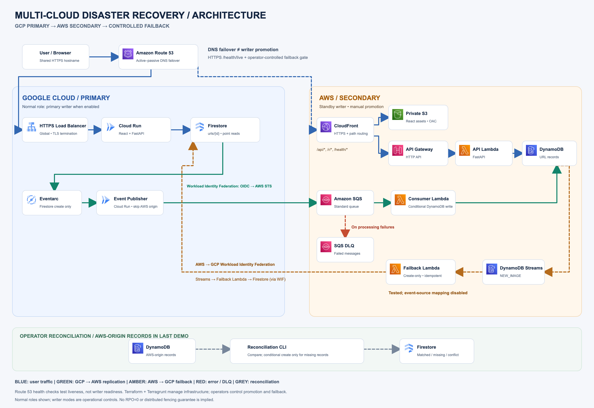

# Multi-Cloud Disaster Recovery: GCP to AWS

## Project Overview

This proof of concept demonstrates active-passive disaster recovery for a URL shortener across Google Cloud and AWS. Google Cloud is the primary environment; AWS is the secondary. Data is replicated asynchronously, while DNS failover, writer promotion, and failback are coordinated as separate operations.

## Architecture

On GCP, a global HTTPS load balancer routes requests to a Cloud Run service running React and FastAPI, backed by Firestore. On AWS, Route 53 directs traffic to CloudFront, which serves the React frontend from private S3 and routes API requests to API Gateway and Lambda, backed by DynamoDB.

Eventarc, a Cloud Run publisher, SQS with a dead-letter queue, and a consumer Lambda provide forward replication. The reverse path uses DynamoDB Streams and a failback Lambda, supported by an operator-run reconciliation CLI.

## How It Works

1. **Normal operation:** GCP serves requests and accepts writes. AWS remains a read-only secondary.
2. **Asynchronous replication:** Firestore create events reach Eventarc and the publisher, which sends them to SQS. The consumer writes them to DynamoDB. AWS-origin records are skipped by the GCP publisher to avoid a replication loop.
3. **DNS failover:** Route 53 health checks can direct clients to AWS. Existing replicated URLs can be read there; DNS failover alone does not enable writes.
4. **AWS writer promotion:** An operator first ensures the GCP writer is stopped, then separately promotes the AWS writer to accept new URLs.
5. **AWS → GCP replication:** DynamoDB Streams can deliver AWS-origin inserts to a failback Lambda, which uses short-lived federated credentials and conditional Firestore creates. This path was tested in a real cloud environment.
6. **Reconciliation and failback:** After AWS writes stop, the reconciliation CLI compares AWS-origin records, identifies missing records and conflicts, and can conditionally create an individually approved missing record. An operator verifies consistency and controls the return of the writer and DNS traffic to GCP.

## Key Engineering Features

- Terraform modules and Terragrunt configurations for infrastructure as code.
- Cross-cloud workload identity federation with short-lived credentials in both directions.
- Scoped IAM permissions and health-based Route 53 DNS failover.
- Asynchronous replication with SQS, a dead-letter queue, and idempotent, conflict-aware handling.
- Reconciliation for backfill and verification before controlled failback.

## DR Validation

A controlled scenario was exercised in the real cloud environments: URLs created on GCP were available on AWS after DNS failover, and URLs created on AWS were transferred back to GCP through reconciliation before failback. The Streams-based reverse path was also tested separately. These tests simulated controlled transitions rather than a provider-wide outage; they do not establish an RTO, RPO, or zero-data-loss guarantee.

## Repository Structure

- `app/` — FastAPI application and storage adapters.
- `frontend/` — React user interface.
- `functions/` — publisher, replication consumer, and failback components.
- `infra/modules/` and `infra/live/` — reusable Terraform modules and Terragrunt environment configurations.
- `scripts/` — operational utilities, including reconciliation.
- `docs/architecture/` — architecture diagrams and visual assets.

## Limitations

- DNS resolver caching and propagation can delay or vary client transitions.
- Asynchronous replication can lag or fail; recent writes may require recovery or reconciliation.
- Writer promotion and failback require operator action and verification. Writer modes alone are not distributed fencing.
- This is a proof of concept, not a production-ready or fully automated DR platform.
